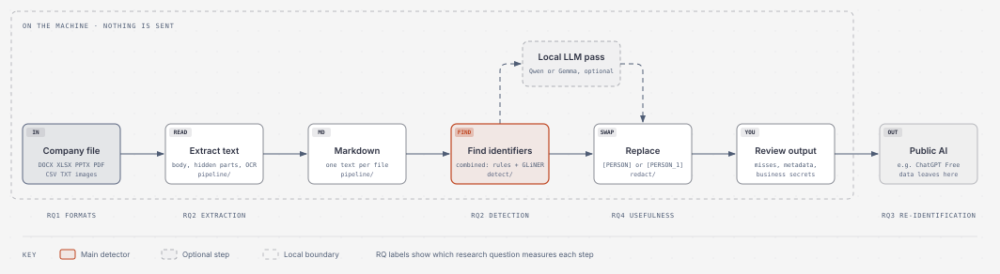
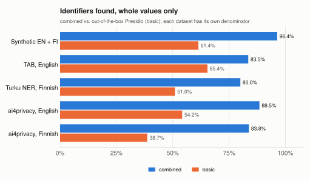
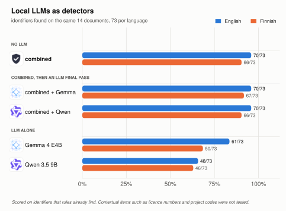
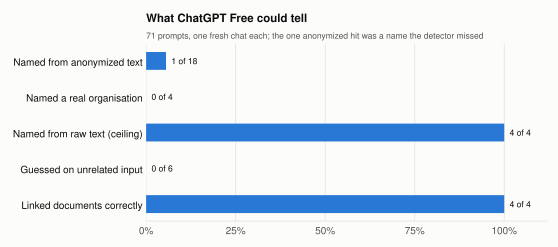
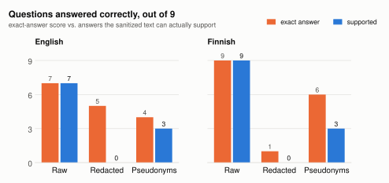

# Anonymizing documents before they go to public AI

A Turku AMK student research project (AI-Powered SME Growth programme, Task 1).
It builds a local anonymization pipeline and measures whether it is safe and
practical to use before a company document is pasted into a public AI model
such as ChatGPT Free.

Research code, not a product. All test data is synthetic or public; no real
company data is in this repository. Local AI deployment as a topic (Task 2)
belongs to another group; local LLMs appear here only as optional detectors.

## The problem

A small company with no agreement with an AI provider has no processor
contract, no deletion guarantee and no control over training on its input.
Anonymizing the document first is the main control it has.

Two problems are easy to confuse:

1. **Personal data.** Anonymization can solve this: done properly, the text
   stops being about a person.
2. **Confidential business information.** Anonymization does not solve this.
   A redacted design document is still a design document.

**Assignment question:** What safe and practical methods and tools are available
for anonymizing different document formats before submitting information to
publicly available AI models?

## Research questions

| | Question | Answered in |
|---|---|---|
| RQ1 | Which tools exist: free or paid, local or cloud, for which formats? | [options-map](docs/options-map.md) |
| RQ2 | How accurately do they find identifiers in English and Finnish, across formats? | [dataset-audit-runs](docs/dataset-audit-runs.md), [local-llm-comparison](docs/local-llm-comparison.md) |
| RQ3 | After anonymization, can a public AI still identify the person or organisation? | [public-ai-results](docs/public-ai-results.md) |
| RQ4 | Does the text stay useful, and what does it cost in setup and data exposure? | [utility-impact](docs/utility-impact.md) |

## What was built

A local pipeline. It reads a file, turns it into Markdown, finds identifiers,
replaces them and saves the result. Nothing leaves the machine.



- **Formats:** TXT/MD, CSV, DOCX, XLSX, PPTX, PDF and images, with OCR for
  images and scans. Document properties, notes, comments and other hidden
  content are read too.
- **Detectors**, all behind one interface: `basic`, `rules` and `rules-lg`
  (Presidio with small or large spaCy models plus custom patterns), `gliner`
  and `gliner2` (local NER models), `privacy-filter`, and `combined` (rules plus
  GLiNER, the main method). An optional local LLM (Qwen or Gemma) can run a
  final pass.
- **Replacement:** a type label such as `[PERSON]`, or consistent pseudonyms
  such as `[PERSON_1]`.
- **Testbench:** a local Streamlit page to watch extract, detect and clean
  ([app/](app/README.md)).

Details: [pipeline](docs/pipeline.md) and [techniques](docs/techniques.md).

## How it was evaluated

- **Detection (RQ2):** whole-value recall against labelled data. A value counts
  only when one detection covers all of it, because a partly masked identifier
  still leaks. Data: a synthetic English/Finnish corpus with planted values, the
  Text Anonymization Benchmark (TAB, English court judgments), Turku NER
  (Finnish) and ai4privacy (English and Finnish).
- **Re-identification (RQ3):** anonymized text pasted into ChatGPT Free, one
  fresh chat per prompt. The model was asked to name the organisation or
  person, guess attributes, and say whether two documents share a source.
  Controls: raw documents (ceiling) and unrelated documents (guess rate).
- **Usefulness (RQ4):** the same questions asked on raw, redacted and
  pseudonymized versions of fictional memos, answered by a local model.

Protocol: [evaluation](docs/evaluation.md).

## Results

### RQ1: options

Nine products surveyed: four free local tools, three metered cloud APIs and
two proprietary platforms, plus this project's detectors and local LLMs. Cloud
services receive the document before redaction; only local options keep it on
the machine. Email, logs and code, CAD and audio/video are desk research only.
[Options map](docs/options-map.md).

### RQ2: accuracy of `combined`

<picture>
  <source media="(prefers-color-scheme: dark)" srcset="docs/figures/rq2-recall-dark.svg">
  
</picture>

| Dataset | Values found / labelled |
|---|---|
| Synthetic English + Finnish, all locations | 1,849 / 1,919 (96.4%) |
| TAB, English court judgments | 4,269 / 5,112 (83.5%) |
| Turku NER, Finnish | 80 / 100 |
| ai4privacy English | 1,757 / 1,986 (88.5%) |
| ai4privacy Finnish | 1,636 / 1,953 (83.8%) |

- On the like-for-like ai4privacy data, Finnish trails English (83.8% vs 88.5%).
- Higher recall costs precision. Lower-bound precision falls from 81.0%
  (basic) to 63.7% (combined) on TAB, and from 52.2% to 26.5% on Turku.
- Extraction: 946 of 960 planted values reach the text; all 14 misses are OCR
  errors ([residual-misses](docs/residual-misses.md)).
- Local LLMs were tested two ways: alone, and as an extra pass after
  `combined`. Alone they find fewer identifiers; as an extra pass they add at
  most one ([comparison](docs/local-llm-comparison.md)). This test only covered
  identifiers that rules already find; contextual items such as licence
  numbers and project codes are untested
  ([#73](https://github.com/Riteshbhandarii/data-anonymization/issues/73)).

<picture>
  <source media="(prefers-color-scheme: dark)" srcset="docs/figures/rq2-local-llm-dark.svg">
  
</picture>

Source: [dataset-audit-runs](docs/dataset-audit-runs.md).

### RQ3: can public AI re-identify?

ChatGPT Free (self-reported GPT-6), 71 prompts, one run each
([results](docs/public-ai-results.md)).

<picture>
  <source media="(prefers-color-scheme: dark)" srcset="docs/figures/rq3-reidentification-dark.svg">
  
</picture>

| Test | Result |
|---|---|
| Naming the person or company from anonymized text | 1 of 18 |
| Naming the organisation behind real public documents | 0 of 4 |
| Naming from raw text (ceiling) | 4 of 4 |
| Guessing on unrelated documents (control) | 0 of 6 |
| Telling whether two documents share a source | 4 of 4 |

- The one naming hit was a detector miss: a Finnish company name stayed in the
  text and the model read it back.
- The real document pair was linked through file metadata that anonymization
  left untouched.
- Leftover content still gives away the sector of every real document.

### RQ4: usefulness and cost

Nine questions per language, answered by a local Qwen model
([utility-impact](docs/utility-impact.md)). Exact-answer scoring credits
guesses, so the supported count is shown too.

<picture>
  <source media="(prefers-color-scheme: dark)" srcset="docs/figures/rq4-usefulness-dark.svg">
  
</picture>

| Language | Raw | Redacted, exact / supported | Pseudonymized, exact / supported |
|---|---:|---:|---:|
| English | 7/9 | 5/9 / 0/9 | 4/9 / 3/9 |
| Finnish | 9/9 | 1/9 / 0/9 | 6/9 / 3/9 |

- Redaction removed every value the tasks needed: hour figures were masked as
  dates and all contacts became the same `[PERSON]`.
- Pseudonyms kept only who-is-who, which answered the same-contact questions.
- The local pipeline is free to run and keeps data on the machine, but needs
  Python, model downloads and Tesseract. Cloud tools are metered and receive
  the document.

## Conclusion

1. Local anonymization with rules plus a NER model removes most identifiers,
   but not all, and Finnish is harder.
2. In this test ChatGPT Free named nothing once names were masked. The leaks
   were detector misses and untouched metadata, not model inference.
3. Redaction can destroy the task. Pseudonyms keep relationships between
   people but not masked values.
4. Anonymization is not enough for confidential business content, and no tool
   tested shows that arbitrary documents are safe to send. Review the output
   before pasting.

## Limitations

Small samples, synthetic and public data only, one public model and no web
search condition. Full list: [limitations](docs/limitations.md).

## Reproduce

Python 3.10+, Tesseract for OCR.

```bash
python -m pip install -r requirements-evaluation.txt
python -m spacy download en_core_web_sm
python -m spacy download fi_core_news_sm

# synthetic corpus with planted identifiers, and its self-check
python corpus/generate.py --out outputs/corpus --n 5 --seed 42
python corpus/verify.py outputs/corpus

# extraction recall and a detector baseline on that corpus
python -m pipeline.validation outputs/corpus --report-dir outputs/validation
python eval/bench.py outputs/corpus

# tests
python -m unittest discover -s tests
```

The seven-method matrix (`python -m eval.run_matrix`) needs the TAB, Turku and
ai4privacy datasets cached locally; see [dataset-audit-runs](docs/dataset-audit-runs.md).
The local-LLM and usefulness runs need LM Studio; commands are in
[local-llm-comparison](docs/local-llm-comparison.md) and
[utility-impact](docs/utility-impact.md). The ChatGPT study is manual; its pack
is described in [public-ai-pack](docs/public-ai-pack.md). Its answer key and
the real source documents are deliberately not in the repository.

## Repo map

| Path | Contents |
|---|---|
| `pipeline/` | Format detection, extraction and OCR, Markdown output |
| `detect/` | The detector methods and the local-LLM final pass |
| `redact/` | Span replacement and consistent pseudonyms |
| `corpus/` | Synthetic corpus generator and verifier |
| `eval/` | Benchmarks, study helpers, saved results in `eval/baselines/` |
| `app/` | Local Streamlit testbench |
| `research/` | Scripts for the commercial-service tests |
| `tests/` | Regression tests |
| `docs/` | Methods, results and limitations; start at the [docs index](docs/README.md) |

Licence: MIT, see [LICENSE](LICENSE).
