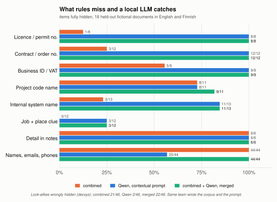

# Contextual identifiers and local LLMs

[Docs index](README.md) › RQ2

Can a local LLM catch what rules and NER miss: licence and contract numbers,
business IDs, project code names, system names and identifying clues? This
doc corrects how the earlier local-LLM test was scored and tests the LLM on
contextual identifiers. Measured locally on 2026-10-20 with Qwen 3.5 9B and
Gemma 4 E4B in LM Studio.

## Key result

- The earlier test undercounted the LLMs: it required the right type label. Counting any detection that hides the value, Qwen alone hides 144/146 identifiers, not 94/146.
- Running the LLM on text that `combined` has already masked loses context: `combined → Qwen` hides 140/146.
- Running both on the original text and merging their detections hides 146/146. That corpus has little unlabelled prose, so its 0.12% over-masking says little; on the contextual corpus the merged design masks 9.6% of characters outside labels.
- On contextual items `combined` hides 26/71. Merged with Qwen and a contextual prompt it hides 58/71, including every licence, contract and business-ID number.
- `combined` alone wrongly hides 21 of 46 look-alikes (decoys). Qwen with the contextual prompt hides 2.

<picture>
  <source media="(prefers-color-scheme: dark)" srcset="figures/rq2-contextual-llm-dark.svg">
  
</picture>

## 1. The earlier test undercounted the LLMs

The [local comparison](local-llm-comparison.md) counted a value as found only
when a span of the right type covered it. The LLMs often found the right text
but chose another label from their list: Qwen tagged English addresses as
`PHONE_NUMBER` and used `QUASI_IDENTIFIER` as a catch-all, and Gemma tagged
addresses as `INVOICE` or `ORGANIZATION`. For privacy the label does not
matter; the value is hidden either way.

Same 14 documents and 146 body labels as before:

| Configuration | Typed (earlier metric) | Hidden by any span | EN | FI | Masked outside labels |
|---|---:|---:|---:|---:|---:|
| `combined` | 136 | 139 | 71 | 68 | 0.07% |
| Qwen alone | 94 | **144** | 72 | 72 | 0.05% |
| Gemma alone | 111 | 133 | 72 | 61 | 0.00% |
| `combined → Qwen` (LLM on masked text) | 136 | 140 | 71 | 69 | 0.07% |
| `combined → Gemma` (LLM on masked text) | 137 | 140 | 71 | 69 | 0.07% |
| `combined + Qwen`, merged | — | **146** | 73 | 73 | 0.12% |
| `combined + Gemma`, merged | — | 143 | 73 | 70 | 0.07% |

The reruns reproduced the stored typed totals exactly (94 and 111 alone,
136 and 137 final pass). `combined` misses seven values, five of them
company names, including the Finnish company that ChatGPT read back in the
[public-AI test](public-ai-results.md). Qwen alone finds all seven. The final
pass does not, because the context around them is masked. The two methods
miss different values, so merging them covers everything.

<picture>
  <source media="(prefers-color-scheme: dark)" srcset="figures/rq2-local-llm-dark.svg">
  
</picture>

## 2. Contextual identifiers

### Corpus

24 fictional documents, 12 English and 12 Finnish, generated by
[eval/contextual_corpus.py](../eval/contextual_corpus.py) with seed 42: memos,
emails, meeting notes, slide decks with speaker notes and comment threads.
Each holds 2–3 ordinary identifiers, 3–5 contextual items and 2–3 decoys
that must stay visible (job titles, standards, quantities, country names).
Six documents are a dev set; results below are the 18 held-out test documents.

### Configurations

- `combined`: rules + GLiNER, run first in its own process.
- Qwen alone, with the original identifier prompt or a new contextual prompt
  (`prompt="contextual"` in [detect/local_llm.py](../detect/local_llm.py)). The
  contextual prompt asks only what could still reveal which company or person
  a document concerns, with short examples written independently of the corpus.
- `combined → Qwen`: the contextual prompt on text with `combined`'s spans masked.
- `combined + Qwen`, merged: both on the original text, detections combined
  (`UnionDetector`).

### Results, test split

| Category | Planted | `combined` | Qwen, identifier prompt | Qwen, contextual prompt | `combined → Qwen` | `combined + Qwen`, merged |
|---|---:|---:|---:|---:|---:|---:|
| Licence / permit no. | 8 | 1 | 7 | 8 | 5 | **8** |
| Contract / order no. | 12 | 3 | 12 | 12 | 10 | **12** |
| Business ID / VAT | 9 | 5 | 9 | 9 | 7 | **9** |
| Project code name | 11 | 8 | 5 | 8 | 9 | **9** |
| Internal system name | 13 | 3 | 9 | 11 | 9 | **11** |
| Job + place clue | 12 | 0 | 0 | 3 | 1 | **3** |
| Detail in notes | 6 | 6 | 6 | 6 | 6 | **6** |
| **Contextual, total** | **71** | **26** | 48 | 57 | 47 | **58** |
| Names, emails, phones | 44 | 44 | 44 | 25 | 44 | **44** |
| Decoys wrongly hidden | 46 | 21 | 10 | **2** | 22 | 22 |
| Masked outside labels | | 8.9% | 1.1% | 0.9% | 9.1% | 9.6% |

What this shows:

- **Rules miss what has no fixed shape.** `combined` hides 1 of 8 licence
  numbers and 3 of 13 system names, and no job-and-place clue in full.
- **The contextual prompt is the better instruction.** It beats the identifier
  prompt on contextual items (57 vs 48) and over-masks less (2 vs 10 decoys).
  It skips most names and emails because it is told they are already hidden.
  That instruction was written for masked text, yet the merged design runs it
  on the original text. An original-text prompt variant was subsequently
  implemented and evaluated in the follow-up section below.
- **Merging keeps the strengths of both.** All standard identifiers come from
  `combined`, the contextual ones from Qwen.
- **Over-masking comes from `combined`.** It hides 21 of 46 decoys: 8 of 11
  job titles as `PERSON` ("finance director"), 5 of 6 generic places
  ("Finland", "the warehouse"), 6 of 15 durations and quantities as dates
  ("18 months") and 2 of 6 ISO standard numbers as dates. Merging inherits that.
- **Job-and-place clues stay hard.** Whole phrases are hidden in at most 3 of
  12; most are hidden in part, which may or may not remove the identifying detail.

Runtime: `combined` 12.5 s for 24 documents; Qwen alone with the contextual
prompt 134 s, about 5.6 s per document on a 16 GiB Mac. No document failed.
The model returned 5 entities whose text was not in the document; they were
dropped and counted.

## Limitations

- The same team wrote the corpus and the prompt. Prompt examples were written
  without the corpus values, and results are reported on held-out documents,
  but the categories were known to both.
- Synthetic documents, one run per configuration, one model size each.
- Runtime grows with length: about 5.6 s per short document here. A long
  export of 400,000 characters is over 100 windows, so the merged design costs
  minutes or more per long document on this laptop.
- Gemma and the identifier-prompt final pass were stopped to limit load on
  the laptop and are not reported for the contextual test.
- On masked text Qwen sometimes repeated itself until its 2,048-token limit,
  which made the final pass slow and is another reason to prefer merging.
- A follow-up ChatGPT before/after test was completed on one synthetic
  document. No identifying categories were recovered after masking under
  the fixed test question. This is preliminary evidence, not a general
  guarantee against re-identification (see the follow-up section below).

## Reproduce

```bash
python -m eval.contextual_corpus --out outputs/contextual-corpus --seed 42
HF_HUB_OFFLINE=1 GLINER_DEVICE=cpu python -m eval.contextual_bench base outputs/contextual-corpus \
  --out outputs/contextual-llm/base-combined.json
lms load qwen/qwen3.5-9b --context-length 8192 --parallel 1 --identifier qwen-local --yes
python -m eval.contextual_bench llm outputs/contextual-corpus --model qwen-local --prompt contextual \
  --out outputs/contextual-llm/qwen-alone-contextual.json \
  --spans-out outputs/contextual-llm/qwen-alone-contextual-spans.json
python -m eval.contextual_bench union outputs/contextual-corpus --base outputs/contextual-llm/base-combined.json \
  --llm outputs/contextual-llm/qwen-alone-contextual.json \
  --llm-spans outputs/contextual-llm/qwen-alone-contextual-spans.json \
  --out outputs/contextual-llm/union-qwen-contextual.json
lms unload qwen-local
```

The any-type rescoring of the 14-document corpus uses `--spans-out` on
`eval.local_llm_bench` and [eval/union_spans.py](../eval/union_spans.py) to
merge saved span logs. Aggregates:
[diagnosis](../eval/baselines/contextual-llm-diagnosis-2026-10-20.json),
[contextual test](../eval/baselines/contextual-llm-2026-10-20.json). Span
logs and corpus text stay in the Git-ignored `outputs/`.

## Related

- [Local LLM comparison](local-llm-comparison.md): the original typed test
- [Residual misses](residual-misses.md): what `combined` misses and why
- [Public AI results](public-ai-results.md): the Finnish company leak
- [Limitations](limitations.md)

## Follow-up evaluation: original-text prompt and real UK licences

Additional local testing was carried out in October 2026 using Qwen 3.5 9B
through LM Studio.

### Original-text contextual prompt

The existing contextual prompt assumes that names, emails and other standard
identifiers have already been masked. However, the merged detector runs Qwen
on the original document.

A new prompt, `original_contextual`, was added to test this situation.
It asks the LLM to detect contextual identifiers in unmasked text.

Both prompts were tested on the same six development documents.
These documents contain 23 contextual items; the separate 18-document
test split contains 71 contextual items.

For the Qwen-only rows, the model received the original, unmasked text.
For the Combined + Qwen rows, both detectors independently processed
the original text and their saved detection spans were merged (Union).
This is different from `combined → Qwen` (Final Pass), where Combined
masks identifiers before Qwen processes the remaining text.

| Configuration | Contextual items fully detected |
|---|---:|
| Combined | 8/23 (34.8%) |
| Qwen, contextual prompt | 20/23 (87.0%) |
| Qwen, original_contextual prompt | 18/23 (78.3%) |
| Combined + Qwen, contextual (Union) | 21/23 (91.3%) |
| Combined + Qwen, original_contextual (Union) | 19/23 (82.6%) |

The existing contextual prompt performed better on this small development
set. The original-text variant detected more standard identifiers when
Qwen was used alone (6/16 versus 3/16). The new prompt was kept for
comparison rather than changing it to fit the development examples.

### Full-corpus evaluation of the original-text prompt

To evaluate the new `original_contextual` prompt, Qwen 3.5 9B was
run alone on all 24 original, unmasked documents. No Combined Detector
or base masking was used.

The table reports the held-out test split of 18 documents. Both prompt
results use the same corpus SHA-256.

| Metric | Qwen `contextual` | Qwen `original_contextual` |
|---|---:|---:|
| Standard identifiers fully covered | 25/44 (56.8%) | 11/44 (25.0%) |
| Contextual identifiers fully covered | 57/71 (80.3%) | 56/71 (78.9%) |
| Decoys wrongly masked | 2/46 | 0/46 |
| Characters masked outside labels | 0.85% | 0.19% |

The new prompt did not improve standard-identifier coverage.
It also detected slightly fewer contextual identifiers, although
it produced less over-masking in this evaluation.

One likely limitation is that `CONTEXT_TYPES` does not include
dedicated entity types for emails, phone numbers or bank accounts.
These values may therefore be missed by the contextual detector.

The original-text prompt remains an optional experimental variant.
The existing `contextual` prompt remains the default for contextual
LLM evaluation.

The new run had no failed documents and dropped two entities whose
returned text was absent from the source document. LLM request time
was 317.454 seconds, excluding model loading.

This evaluation uses the same corpus as the earlier benchmark but was
run separately. The results should not be interpreted as evidence
that the new prompt is more accurate overall.

### Real UK licence spreadsheet

A public licensed-premises spreadsheet from Leicester City Council was
used to test licence-number detection on real records.

The spreadsheet contained 1,475 records. A reproducible sample of 30
different licence numbers was selected, covering four number prefixes.

| Configuration | Licence numbers detected | Recall |
|---|---:|---:|
| Combined | 0/30 | 0.0% |
| Qwen, original_contextual | 30/30 | 100.0% |
| Combined + Qwen | 30/30 | 100.0% |

Combined detection took 8.12 seconds, while Qwen took 183.51 seconds.
The sum was 191.63 seconds. These timings exclude model initialization;
the merged pipeline was not timed as a separate run.

All 177 detected spans from the two individual detectors were reviewed.
The review marked 174 as correct and 3 as false positives. These are
span-level review counts, not a document-level false-positive rate.

This test supports the conclusion that the local LLM can find licence
numbers missed by the existing detector.

There are important limitations. Only 30 records were tested, all from
one source, and every test sentence explicitly included the label
"Licence number:". The result does not establish 100% recall on other
licence formats or on documents without that label. The combined result
was calculated by merging saved spans from the two detectors.

#### Reproducing the UK licence sample

Source: Leicester City Council, Licensed Premises Register.

Dataset page:
https://data.leicester.gov.uk/explore/dataset/licensed-premises-register/

The dataset was listed as updated on 17 June 2026.
The local XLSX file was created on 23 October 2026.
This local timestamp is not proof of the exact download date.

Download the XLSX from the dataset page and verify its SHA-256
against the value below before reproducing the experiment.

Source file SHA-256:
`5760EBAADEF6B095624D6767E6722F6802E4041B7375080610EF9BF465293319`

The source contains 1,475 unique licence numbers. The 30-record sample
was generated using stratified sampling by licence prefix with Pandas
and `random_state=42`.

To reproduce the sample, place the original XLSX file at
`outputs/uk-licence/licensed-premises-register.xlsx` and run:

    python -m eval.uk_licence_sample

The script writes `outputs/uk-licence/uk_licence_test_30.csv`.
It does not overwrite an existing file.

The generated sample was compared with the original test CSV and
matched all 30 rows and every column.

Each test sentence follows this structure:

    Licence number: [LICENCE]. Operating name: [OPERATING_NAME].
    Licence holder: [LICENCE_HOLDER]. Premises address: [ADDRESS], [TOWN].

The expected identifier is the licence number, labelled `IDENTIFIER_CODE`.

#### Manual span review

The two detectors returned 177 spans across the 30 test sentences:

- Combined Detector: 88 spans
- Qwen: 89 spans

The detected spans include licence numbers, organization names,
person names, locations, and other entity types.
They are not 177 separate licence numbers.

Manual review classified 174 spans as correct and 3 as false positives.

All three false positives were the generic phrase `Off Licence`,
incorrectly identified as an organization.

A span was marked correct when the detected text represented meaningful
identifying information in the test sentence. The review also checked
whether detected licence numbers matched the ground truth.

These are manual judgments of returned spans, not an exhaustive
evaluation of all possible identifiers in the documents.

Therefore, the 174/177 result should not be interpreted as overall
precision or recall against fully annotated ground truth.

### ChatGPT before/after identification test

One fictional English memo from the contextual corpus (`en-01.md`) was
tested before and after anonymization using Combined + Qwen with the
existing `contextual` prompt.

The same identification question was used in separate ChatGPT chats.
The question asked for the person, organization, permit reference,
internal project and internal system, without guessing.

| Result | Before anonymization | After anonymization |
|---|---:|---:|
| Identifying categories recovered | 5/5 | 0/5 |

The organization in the original document was inferred from the sender's
email domain rather than explicitly named. After anonymization, ChatGPT
could not identify any of the five requested items.

The result is limited to one synthetic document and one fixed question.
It does not prove that all re-identification attacks would fail.
The anonymized output also removed some ordinary contextual information,
showing a trade-off between privacy and document usefulness.

### Independent blind test (Issue #75)

Eight fictional business documents were provided for blind evaluation:
four English and four Finnish documents, comprising six DOCX files and
two PPTX files with speaker notes.

The supplied Excel ground truth contained 50 unique values to mask and
38 values to keep. Counting repeated appearances in the extracted text
produced 89 mask occurrences and 42 keep occurrences.

The evaluation used occurrence-based span coverage. All 8 documents
were assigned to the test split. The existing `original_contextual`
prompt was used without modification.

#### Overall results

| Method | Covered | Recall | Keep occurrences masked |
|---|---:|---:|---:|
| Qwen 3.5 9B alone | 44/89 | 49.4% | 0/42 |
| Combined alone | 71/89 | 79.8% | 10/42 |
| Combined + Qwen (Union) | 89/89 | 100.0% | 10/42 |

Union merges independently detected spans from Combined and Qwen on
the original extracted text. It is not the masked final-pass workflow.

#### Results by language

| Method | English recall | Finnish recall | English keep masked | Finnish keep masked |
|---|---:|---:|---:|---:|
| Qwen | 27/47 (57.4%) | 17/42 (40.5%) | 0/22 | 0/20 |
| Combined | 37/47 (78.7%) | 34/42 (81.0%) | 6/22 | 4/20 |
| Union | 47/47 (100.0%) | 42/42 (100.0%) | 6/22 | 4/20 |

#### Over-masking

Combined incorrectly masked 10 annotated keep occurrences:

- 8 project-duration values
- 1 job title (`Project Coordinator`)
- 1 quality standard (`ISO 9001`)

Union retained these errors because it combines detections rather
than removing incorrect spans from Combined.

#### Evaluation details

Qwen model: `qwen_qwen3.5-9b`
Prompt: `original_contextual`
Temperature: 0
Reasoning effort: none
Failed documents: 0
Dropped entities: 0
LLM request time: 88.929 seconds

Corpus SHA-256:
`bd92386900c3ed9307f39497946e8059fd643b9a7a630caacd7d72795232e37f`

The existing pipeline extractor converted DOCX and PPTX files to
Markdown, including PowerPoint speaker notes. Markdown line endings
were normalized to LF so ground-truth offsets matched the benchmark.

The three methods were evaluated against the same frozen corpus.
The 100% Union recall applies only to the 89 annotated occurrences
in these eight fictional documents. It does not demonstrate perfect
real-world detection or full-document precision.

The anonymized evaluation reports and source documents are retained
locally under `outputs/blind-test/` and are not included in this PR.
Reproducing the results requires the independently supplied blind
documents and their ground truth.

The PPTX extractor required a local fix to process one supplied slide
deck. That fix is not included in this PR and requires separate
regression testing before integration.

The requirement that the blind-test author had not read the LLM
prompt before preparing the documents should be confirmed with
the document author before treating the dataset as fully independent.
